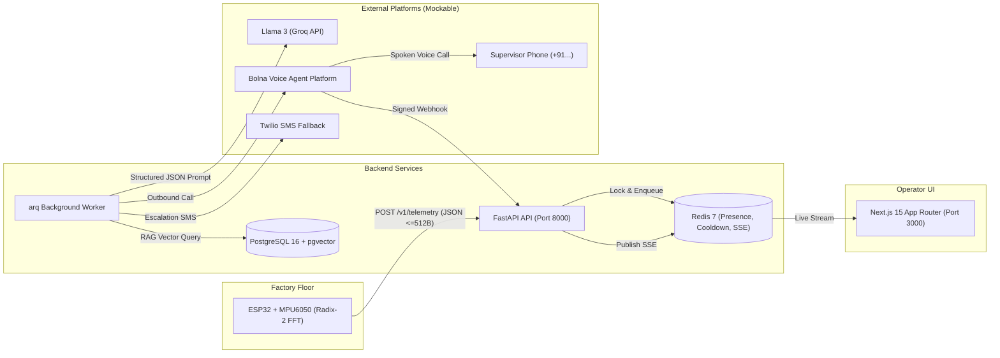

# Proactive Edge-to-Voice Machine Copilot

Prevent unplanned downtime in small manufacturing units by detecting early machine faults at the edge and proactively reaching the shift supervisor by phone with a plain-language diagnosis.

---

## 1. System Overview & Architecture



- **Edge (Firmware):** ESP32 + MPU6050 sampling at 1000 Hz, pure iterative Radix-2 512-point FFT with Hann windowing, Welford running baseline calibration, $k\sigma$ persistence detection, and compact JSON payloads ($\le 512$ bytes).
- **API & Core:** Python 3.12 + FastAPI with strict ULID IDs (`mch_`, `dev_`, `evt_`, `cal_`, `not_`, `man_`, `usr_`), rate limiting (6/min per device), daily call caps (5/day per machine), 30-minute cooldowns, and HMAC-SHA256 signature verification.
- **Worker Pipeline:** Python 3.12 + `arq` async queue orchestrating pgvector RAG manual chunk retrieval, LLM synthesis with rule-based fallback, outbound Bolna phone calls, no-answer retries, and SMS escalation.
- **Dashboard:** TypeScript + Next.js 15 (App Router) + Tailwind CSS + Lucide icons with real-time SSE stream reconnection, live presence badges, interactive FFT spectrum charts, and supervisory decision controls.

---

## 2. Quickstart & Demo Setup

### Prerequisites
- Docker & Docker Compose
- Python 3.12+ and `uv` package manager
- Node.js 20+ and `npm`
- MinGW `g++` (for native firmware host tests) or PlatformIO

### Step 1: Clone and Configure Environment
```bash
cp .env.example .env
```
Default configuration is set to `MOCK_EXTERNALS=true`, allowing the full stack and test scenarios to run entirely offline with zero external API dependencies.

### Step 2: Start Infrastructure Services
```bash
make up
# Starts PostgreSQL 16 (with pgvector) and Redis 7 in Docker containers
```

### Step 3: Run Database Migrations
```bash
make migrate
# Applies Alembic migration 0001_initial: tables, enums, pgvector extension, and HNSW cosine indexes
```

### Step 4: Seed Demo Data
```bash
make seed
# Seeds owner@example.com (Password123!), "Centrifugal Slurry Pump #3", and bound sensor node
```

### Step 5: Start Backend API Server
```bash
make api
# Runs FastAPI on http://localhost:8000 (OpenAPI docs at /docs)
```

### Step 6: Start Background Worker
In a separate terminal:
```bash
make worker
# Runs arq worker for RAG, LLM synthesis, voice dispatch, and escalation
```

### Step 7: Start Dashboard Frontend
In a separate terminal:
```bash
make dev
# Runs Next.js App Router on http://localhost:3000
```
Login with:
- **Email:** `owner@example.com`
- **Password:** `Password123!`

---

## 3. Mock Mode Configuration Switches

| Variable | Values | Default | Purpose |
|----------|--------|---------|---------|
| `MOCK_EXTERNALS` | `true`, `false` | `true` | When true, LLM, Bolna, and Twilio bypass real APIs and record calls/SMS to Redis. |
| `MOCK_LLM_MODE` | `valid`, `invalid`, `timeout` | `valid` | Simulates LLM responses (`valid` JSON, `invalid` non-JSON triggering rule fallback, `timeout` triggering arq retries). |
| `EMBEDDING_BACKEND` | `hash`, `local` | `hash` | `hash` uses deterministic 384-dimensional token hashing for fast offline tests; `local` loads HuggingFace `bge-small-en-v1.5`. |
| `NOTIFY_PROVIDER` | `mock`, `twilio` | `mock` | `mock` pushes SMS records to Redis `mock:notifications`; `twilio` dispatches real SMS. |

---

## 4. Test Suites & Verification

### Run Acceptance Scenarios S1–S10 (End-to-End)
```bash
make e2e
# Or: uv run --directory backend python ../simulator/run_scenario.py
```
Validates:
1. `[S1]` Onboarding: User login, machine creation, device binding, 409 conflict.
2. `[S2]` Heartbeat & Config: 204 response, machine device_online presence, device config parameters.
3. `[S3]` Anomaly to Call: Telemetry 202 accepted, worker processing, CALLING status, `mock:calls` record.
4. `[S4]` Decision by Voice: HMAC-SHA256 signed webhook, ACKNOWLEDGED transition, audit log trail.
5. `[S5]` Cooldown & Daily Cap: 30-min suppression, exactly 5 accepted events per day.
6. `[S6]` Duplicate Sequence: Idempotent seq=999 returns identical event_id without duplicate event.
7. `[S7]` Webhook Security: Signature mismatch returns 401 WEBHOOK_SIGNATURE_INVALID.
8. `[S8]` Ownership & Fallback: Cross-owner queries return 404; invalid LLM triggers rule fallback.
9. `[S9]` Escalation & Notification: NO_ANSWER retries exhausted, event ESCALATED, SMS dispatched.
10. `[S10]` Contract Verification: OpenAPI schema and generated TypeScript types match contract.

### Backend Unit & Integration Tests
```bash
make test-unit
# Runs pytest on backend/tests/unit (core utils, rules, state machine, embedding, schemas)

make test-integration
# Runs pytest on backend/tests/integration (DB migrations, API core, telemetry ingest, webhooks, RAG)
```

### Frontend Tests, Typecheck & Production Build
```bash
cd frontend
npm run typecheck   # 0 TypeScript errors
npm test            # 17 Vitest unit & component tests passing
npm run build       # Next.js production build succeeded
```

### Firmware Native Tests (Host Compile)
```bash
make firmware-test
# Compiles firmware/test/test_native with MinGW g++ C++17 and executes Unity test suite:
# - Radix-2 512-point FFT peak accuracy (24.4 Hz fundamental)
# - Welford baseline convergence (mean & variance)
# - Persistence counter & idle thresholding (<0.05g)
# - Compact telemetry JSON serialization (<= 512 bytes)
# - Rule hint generation for 1x imbalance, 2x misalignment, harmonics
```

---

## 5. Device Simulator & Tooling

### ESP32 Device Simulator
Simulates real vibration bursts or heartbeats:
```bash
# Send an imbalance anomaly burst (1x peak dominant at 24.4 Hz)
uv run python simulator/simulate_device.py --mode imbalance --rpm 1465.0

# Send healthy vibration baseline burst
uv run python simulator/simulate_device.py --mode healthy

# Send periodic heartbeat
uv run python simulator/simulate_device.py --heartbeat
```

### Fake Bolna Webhook Dispatcher
Dispatches HMAC-SHA256 signed webhooks simulating supervisor phone call decisions:
```bash
# Simulate supervisor acknowledging alert on call
uv run python simulator/fake_bolna_webhook.py --event-id evt_01... --decision ACKNOWLEDGED

# Simulate call failure / no answer
uv run python simulator/fake_bolna_webhook.py --event-id evt_01... --status no-answer
```

### Device Key Management Script
```bash
uv run python scripts/create_device_key.py --machine-id mch_01...
# Generates a fresh device ID and secure dk_... raw key, storing Argon2id hash in Postgres
```

---


