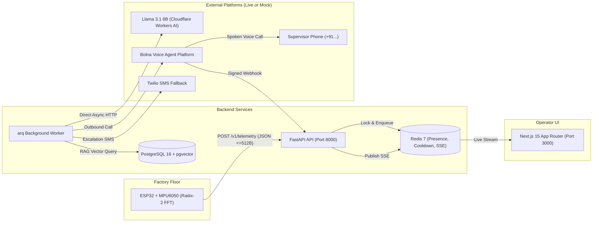

# Proactive Edge-to-Voice Machine Copilot

> **Edge Vibration Anomaly Detection • Cloudflare Workers AI (Llama 3.1 8B) • Proactive Voice Phone Dispatch (Bolna AI)**

Prevent catastrophic unplanned downtime on factory floors by detecting early mechanical anomalies at the edge (ESP32 FFT) and proactively placing phone calls to the shift supervisor in plain conversational language before machines fail.

---

## Architecture Diagram



---

## Features

- **Edge Vibration Anomaly Detection:** Real-time 1000 Hz vibration sampling, 512-point Radix-2 FFT with Hann windowing, Welford running baseline tracking, and persistent $k\sigma$ anomaly detection on ESP32 microcontrollers.
- **AI-Powered Diagnostics:** Automated diagnosis via Llama 3.1 8B Instruct (hosted on Cloudflare Workers AI), grounded with machine technical manuals using PostgreSQL `pgvector` RAG retrieval.
- **Proactive Voice Dispatch:** Autonomous outbound phone calls via Bolna AI to shift supervisors communicating fault severity, ranked probable causes, and capturing decisions over the phone.
- **Live Operator Dashboard:** Modern Next.js 15 App Router dashboard with Server-Sent Events (SSE) for real-time telemetry streaming, interactive FFT spectrum charts, and supervisory action controls.
- **Production Safety & Reliability:** Monotonic packet sequencing, 30-minute alert deduplication cooldowns, prefixed ULIDs (`mch_`, `dev_`, `evt_`), and an immutable database audit trail.
- **Zero-Dependency Mock Mode:** Run the full pipeline 100% offline with zero external API keys or paid accounts needed for testing and evaluation.

---

## Tech Stack

| Layer | Technologies |
|---|---|
| **Edge / Firmware** | C++17, ESP32, MPU-6050 Accelerometer, Radix-2 FFT |
| **Backend API & Queue** | Python 3.12, FastAPI, `arq` (async Redis queue), Pydantic v2, HTTPX |
| **Database & Cache** | PostgreSQL 16 (`pgvector`), Redis 7, SQLAlchemy 2.0 (asyncpg), Alembic |
| **AI & Voice** | Cloudflare Workers AI (Llama 3.1 8B Instruct), Bolna AI Voice Agent |
| **Frontend** | Next.js 15 (App Router), React 19, TypeScript, Tailwind CSS, Lucide Icons |
| **Environment & Tooling** | Docker & Docker Compose, `uv` (Python package manager), `npm` |

---

## Prerequisites

Before getting started, ensure you have the following installed on your machine:

- **[Docker & Docker Compose](https://www.docker.com/)** (v20+ recommended)
- **[Python 3.12+](https://www.python.org/)** with the **[`uv`](https://docs.astral.sh/uv/)** package manager
- **[Node.js 20+](https://nodejs.org/)** with `npm`

---

## Installation & Setup Manual

### 1. Clone & Configure Environment

```bash
git clone https://github.com/harshal663/Kito--Machine-copilot.git
cd Kito--Machine-copilot

# Copy environment template
cp .env.example .env
```

> **Evaluation Setting:** By default, `MOCK_EXTERNALS=true` in `.env` to run 100% offline without external API keys. Set to `false` and add Cloudflare/Bolna credentials when running in production.

### 2. Start PostgreSQL & Redis

Start the containerized PostgreSQL (with `pgvector`) and Redis instances:

```bash
docker compose up -d postgres redis
```

### 3. Run Migrations & Seed Demo Data

```bash
# Apply database migrations
cd backend
uv run alembic upgrade head

# Seed demo factory, machines, and owner account
uv run python ../scripts/seed_demo.py
cd ..
```

*Default Seeded Credentials:*
- **Email:** `owner@example.com`
- **Password:** `Password123!`

### 4. Run the Services

Open three terminal windows to launch the full application stack:

#### Terminal 1: Backend API
```bash
cd backend
uv run uvicorn app.main:app --host 0.0.0.0 --port 8000 --reload
```
*API is accessible at [http://localhost:8000](http://localhost:8000) (Swagger documentation at [http://localhost:8000/docs](http://localhost:8000/docs)).*

#### Terminal 2: Background Worker
```bash
cd backend
uv run arq app.workers.settings.WorkerSettings
```
*Processes RAG vector queries, executes AI diagnostic synthesis, and triggers Bolna voice calls.*

#### Terminal 3: Frontend Dashboard
```bash
cd frontend
npm install
npm run dev
```
*Dashboard opens at [http://localhost:3000](http://localhost:3000).*

---

## Contribution Guidelines

We welcome contributions! Please follow these guidelines to keep the codebase reliable and clean:

### Workflow
1. **Fork** the repository and create a feature branch:
   ```bash
   git checkout -b feature/your-feature-name
   ```
2. **Make your changes** adhering to the project's architecture and coding standards.
3. **Commit** using clear, conventional commit messages:
   ```bash
   git commit -m "feat(backend): add telemetry rate limiter"
   ```
4. **Push** your branch to your fork:
   ```bash
   git push origin feature/your-feature-name
   ```
5. **Open a Pull Request** describing the motivation, changes made, and verification steps.

### Quality & Verification Standards
Before submitting a PR, ensure all checks pass:

- **Backend:**
  ```bash
  cd backend
  uv run ruff check .
  uv run ruff format --check .
  uv run mypy --strict app
  uv run pytest tests/unit
  ```
- **Frontend:**
  ```bash
  cd frontend
  npm run typecheck
  npm test
  ```
- **Safety Invariant:** Software strictly monitors, diagnoses, and advises—it must **never** actuate physical machine shutoffs autonomously without human supervisory sign-off.
